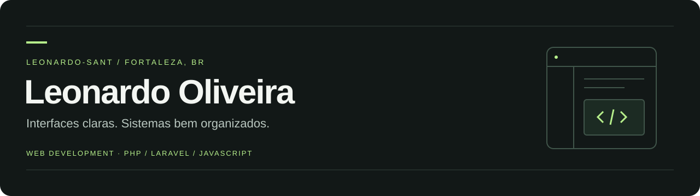

  

  <a href="#projetos-selecionados">Projetos</a> &nbsp; / &nbsp;
  <a href="#tecnologias">Tecnologias</a> &nbsp; / &nbsp;
  <a href="#em-aprendizado">Aprendizado</a>

## Olá, sou o Leonardo.

Desenvolvo projetos web com atenção à interface e à organização do sistema. Meu trabalho recente reúne sites institucionais, uma plataforma com backoffice e integrações por eventos.

Estou em **Fortaleza, Ceará**, e uso este espaço para compartilhar o que construo e o que estou aprendendo.

## Projetos selecionados

### 01 / ApexBet

**Plataforma web · Laravel · PHP · JavaScript · SQLite**

Catálogo de jogos com autenticação, administração de contas, banners, promoções, afiliados e webhooks assinados. Interface em português e inglês.

O projeto permite explorar tanto a experiência do usuário quanto a organização do backoffice. Pagamentos e execução de jogos dependem de integrações externas ainda não implementadas.

[Explorar código e documentação →](https://github.com/Leonardo-sant/apexbet)

---

### 02 / Lottopay

**Site institucional · Next.js · TypeScript · Tailwind CSS**

Site organizado em componentes reutilizáveis, com conteúdo centralizado, layout responsivo e animações com Framer Motion.

[Explorar o projeto →](https://github.com/Leonardo-sant/sitelottopay2)

## Tecnologias

| Área | Tecnologias usadas nos projetos |
| :--- | :--- |
| Interface | HTML, CSS, JavaScript, TypeScript, Next.js, Tailwind CSS |
| Aplicação | PHP, Laravel, Blade, SQLite |
| Integrações | APIs HTTP, webhooks e rastreamento de eventos |
| Ferramentas | Git, GitHub, Composer, Nginx |

## Em aprendizado

Também mantenho meus estudos em **Python**, passando por estruturas de dados, orientação a objetos e desenvolvimento web.

[Ver a trilha de estudos em Python →](https://github.com/Leonardo-sant/trilha-python-dio)

---

Do primeiro layout à organização do sistema — um projeto de cada vez.

